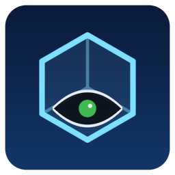
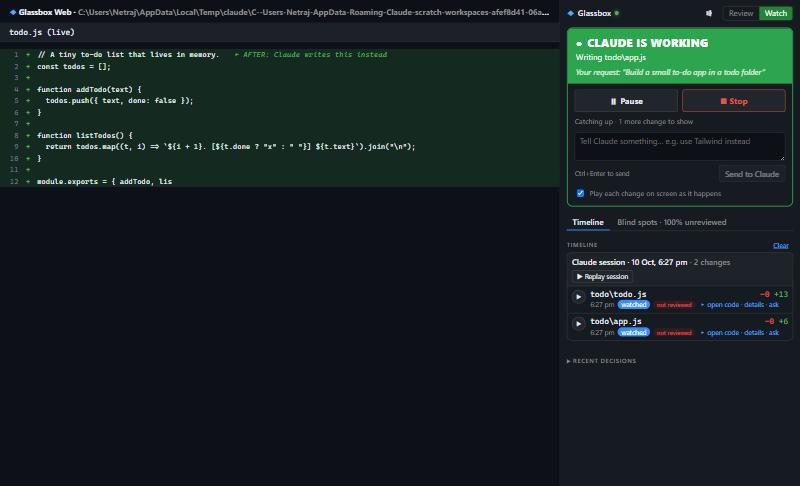
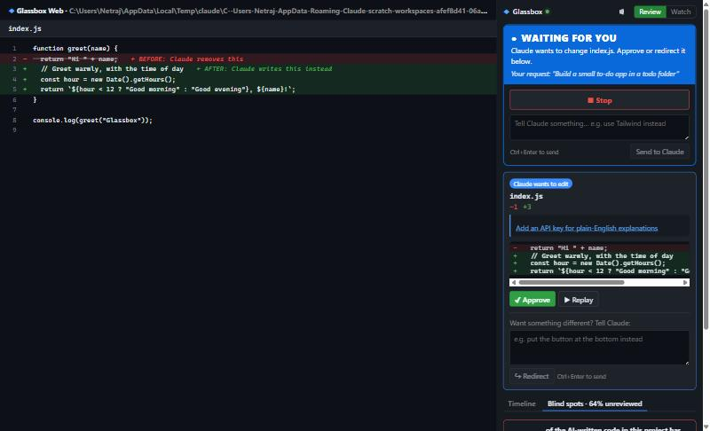
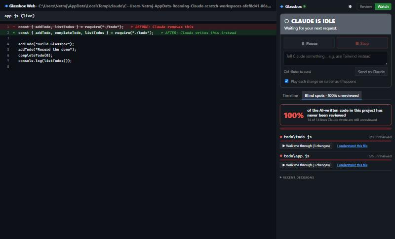

<p align="center">
  
</p>

<h1 align="center">Glassbox</h1>
<p align="center"><b>See through your AI.</b><br>Watch every change Claude Code makes, steer it, replay it, understand it, and find the AI-written code you've never reviewed.</p>

<p align="center"><i>Built entirely by voice with <a href="https://wisprflow.ai">Wispr Flow</a> and Claude Code.</i></p>

---

## The problem

AI coding agents now write a large share of our code. But while they work, you mostly see *"Sifting… Brainstorming…"*, then a wall of diff that's easy to skip. The result:

- You **ship code you don't understand**.
- You can't tell **which parts** of your project you've never actually read.
- Stopping or redirecting the agent mid-task is clumsy.

## The idea

Glassbox turns the AI's work from a black box into a glass box. It sits next to Claude Code (it doesn't replace it) and:

1. **Shows** every edit as it happens. The old code turns red, gets erased, and the new code types itself in green. Then the screen settles on **BEFORE** above **AFTER**.
2. **Lets you steer**: approve or redirect each change, or pause, stop and message Claude at any moment.
3. **Explains** each change in plain English, answers questions about it, and can quiz you on it.
4. **Remembers** everything in a timeline you can replay, one change or a whole session.
5. **Finds your blind spots**: it tracks which AI-written code you've actually reviewed and tells you, for example, *"68% of the AI-written code in this project has never been reviewed."*

## Screenshots

| Watch mode: Claude builds, you watch live | Review mode: Claude waits for your approval |
|---|---|
|  |  |

**Blind Spots: how much AI-written code you've never reviewed**



*(Screenshots are from Glassbox Web, the browser version. The VS Code panel is the same.)*

## Features

### Two ways to work
| | Review mode | Watch mode |
|---|---|---|
| Claude… | pauses before **every** edit | works freely |
| You… | **Approve**, or **Redirect** with an instruction (*"put the button at the bottom"*) and Claude adapts | watch each change play live, with **⏸ Pause**, **■ Stop** and **Tell Claude…** at any moment |
| Best for | careful changes, learning | building from scratch, big tasks |

A large coloured banner always says what's happening: 🟢 **CLAUDE IS WORKING** · 🟡 **PAUSED** · 🔴 **STOPPED** · 🔵 **WAITING FOR YOU** · ⚪ **IDLE**. The status bar shows the same state.

### See every change
- **The Stage:** each edit plays in the editor: old code in red → erased → new code typed in green → BEFORE / AFTER side by side.
- **Replay** any change, or a whole Claude session as a guided tour.
- **Click any change** in the timeline to open the real file with that code highlighted.

### Understand it
- **💡 Explain:** a one-line summary, the steps, and *why* Claude made the change, using its own reasoning from the conversation.
- **Ask:** questions about any change (*"why a loop here?"*).
- **🧠 Quiz me:** a quick multiple-choice check; a correct answer marks the change as understood.
- **🔊 Voice:** reads explanations aloud.

### Blind Spots
Glassbox matches every line Claude wrote against your current code and tracks whether you've looked at it. Approving, replaying, opening, explaining, asking about, or passing a quiz on a change counts as reviewed. Changes that only played past in Watch mode don't.

- A headline score for the whole project, and a red / yellow / green bar per file.
- **AI badges** on files in the Explorer.
- **▶ Walk me through** replays just the changes you haven't seen; **I understand this file** clears it.

### Works where you work
- **VS Code extension.** Also runs in Cursor, Windsurf and Antigravity.
- **Glassbox Web:** the same panel in a browser tab, for people using Claude Code in a terminal or the Claude desktop app.
- **Other AI tools (optional):** records changes made by Cursor's agent, Copilot or Antigravity by watching files. They can be replayed and appear in Blind Spots, but can't be paused.

## How it works

Glassbox uses [Claude Code hooks](https://docs.claude.com/en/docs/claude-code/hooks): small commands Claude Code runs at key moments. **Connect Claude Code** adds Glassbox's hooks to the project's `.claude/settings.local.json` (a personal, git-ignored file).

```
                    ┌──────────────── before every step ───────────────┐
Claude Code ──hook (curl)──►  Glassbox local server (127.0.0.1:7337)   │
            ◄── allow · redirect · pause · stop ──┘     │              │
                                                         ▼              │
                       Stage (animation) · Panel (approve, explain, timeline, blind spots)
```

| Hook | What Glassbox does with it |
|---|---|
| `PreToolUse` (every tool) | Pause / Stop / messages; for edits: show the animation and wait for approval (Review mode) |
| `PostToolUse` (edits) | Record the change in the timeline; play it live (Watch mode) |
| `UserPromptSubmit` / `Stop` | Know when Claude starts and finishes, for the status banner |

- **Redirect** works by declining the edit with your instruction as the reason, so Claude reads it and adapts.
- **Stop** uses Claude Code's `continue: false` to end the turn.
- Everything stays on your machine. If Glassbox isn't running, the hooks do nothing and Claude Code works exactly as before.

## Getting started

### VS Code
1. Build the extension (see [Development](#development)) or download `glassbox-x.y.z.vsix` from Releases.
2. In VS Code: **Extensions → ⋯ → Install from VSIX…**
3. Open your project, click the **Glassbox** icon (the glass cube) in the sidebar, then **Connect Claude Code**.
4. Start (or restart) Claude Code in that folder and give it a task.

For explanations, questions and quizzes, run **Glassbox: Set API Key** with an Anthropic API key (stored encrypted by VS Code). Without one, Glassbox shows Claude's own words about each change.

### Terminal or Claude desktop app (Glassbox Web)
```bash
npm run web -- C:\path\to\your\project
```
A browser tab opens with the same panel and a code view. Set `ANTHROPIC_API_KEY` to turn on explanations.

## Commands and settings

| Command | |
|---|---|
| Glassbox: Connect / Disconnect Claude Code | Add or remove Glassbox's hooks for this project |
| Glassbox: Pause / Resume / Stop Claude | Same as the panel buttons and the status bar |
| Glassbox: Tell Claude… | Send Claude a message before its next step |
| Glassbox: Set / Remove API Key | Turn explanations, questions and quizzes on or off |
| Glassbox: Watch Other AI Tools | Also record changes from other AI tools |
| Glassbox: Show Log | What Glassbox received and decided |

| Setting | Default | |
|---|---|---|
| `glassbox.model` | `claude-opus-5-5` | Model for explanations (`claude-haiku-5-5` is faster and cheaper) |
| `glassbox.port` | `7337` | Local port (the next free one is used if taken) |
| `glassbox.watchOtherTools` | `false` | Record changes made by other AI tools |

## Project structure

```
src/
  extension.ts          Entry point: wires everything together
  server.ts             Local server that receives Claude Code's hooks
  hooks.ts              Connect / Disconnect: writes .claude/settings.local.json
  watch.ts              Pause / Resume / Stop / Tell Claude, and the status banner
  approval.ts           Review mode: the queue of edits waiting for approval
  stage/                Edit planning and the red → erase → green animation
  explain/              Explanations, questions and quizzes (Claude API)
  timeline/             Recording, replay, and Blind Spots
  agents/otherTools.ts  Watching files for changes made by other AI tools
  panel/                The side panel's data and messages
  web/                  Glassbox Web (`glassbox` command-line tool)
webview-ui/             The panel UI (React + Vite), shared by VS Code and the browser
test/core.test.ts       Core logic tests
```

## Development

```bash
npm install
npm --prefix webview-ui install
npm run compile          # extension + Glassbox Web + panel UI
npm run test:core        # core logic tests
npx @vscode/vsce package --no-dependencies --allow-missing-repository   # build the .vsix
```

Press **F5** in VS Code to try the extension in a development window. For a quick demo flow, see [DEMO.md](DEMO.md).

## Built by voice

Glassbox was built by describing it to Claude Code with **Wispr Flow** instead of writing the code by hand. That's fitting for a tool about understanding what the AI writes for you.

## License

[MIT](LICENSE)
